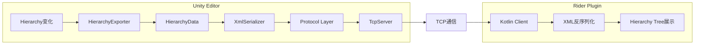

# IDE Hierarchy Viewer

[](https://github.com/NightToona/UnityHierarchyViewerClient)


A Unity Editor extension that synchronizes Unity Hierarchy data with external IDE plugins, reducing context switching between Unity and code editors.

用于将 Unity Hierarchy 实时同步至外部 IDE，**减少开发过程中 Unity 与代码编辑器之间的频繁切换**。

> **当前版本已完成**： Unity Editor 端数据采集、TCP通信、XML序列化、心跳检测以及 Rider 插件数据同步链路。
> 
> **后续优化方向**：通信性能优化、扩展多客户端支持。

## Features

- Unity Editor Hierarchy 变化监听
- GameObject 树形结构递归构建
- XML 数据序列化与反序列化
- **Unity ↔ Rider 跨进程通信架构设计**
- 基于 TCP 的本地进程通信
- 自定义消息协议（MessageType + BodyLength）
- 心跳检测与断线重连机制
- EditorPrefs 配置管理

## Project Introduction Document

[Projects/Project 1 - Hierarchy Tool](https://github.com/NightToona/UnityClient-Engineering-Notes/blob/0089f13df53eada2bcab9eb2dff6a382e4bb3bfd/Projects/Project%201%20-%20Hierarchy%20Tool.md)

## Usage

安装 Package 后，TCP Server 会自动启动。

界面样式：


**默认地址**：

```text
127.0.0.1:44571
```

**设置入口**：
```
Tools > IDE Hierarchy Viewer Setting > Settings
```

**消息格式**：
```
[MessageType][UTF8BodyLength]Body
```

## Development Status





### Completed

- Unity Editor 扩展开发
- Hierarchy 数据采集
- XML 序列化与反序列化
- TCP 通信链路
- 自定义协议设计
- 心跳检测
- Rider 客户端数据同步
- Unity ↔ Rider 跨进程数据同步

### Future Improvements

- 多客户端支持
- 网络层性能优化
- 数据同步性能优化
- 增量更新机制探索

IDE端项目已上线开放：
[Rider Client](https://github.com/NightToona/UnityHierarchyViewerClient)
